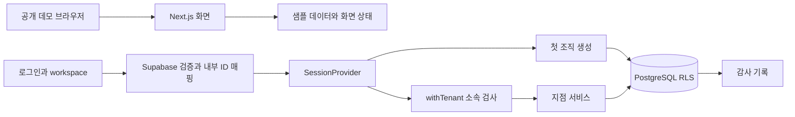
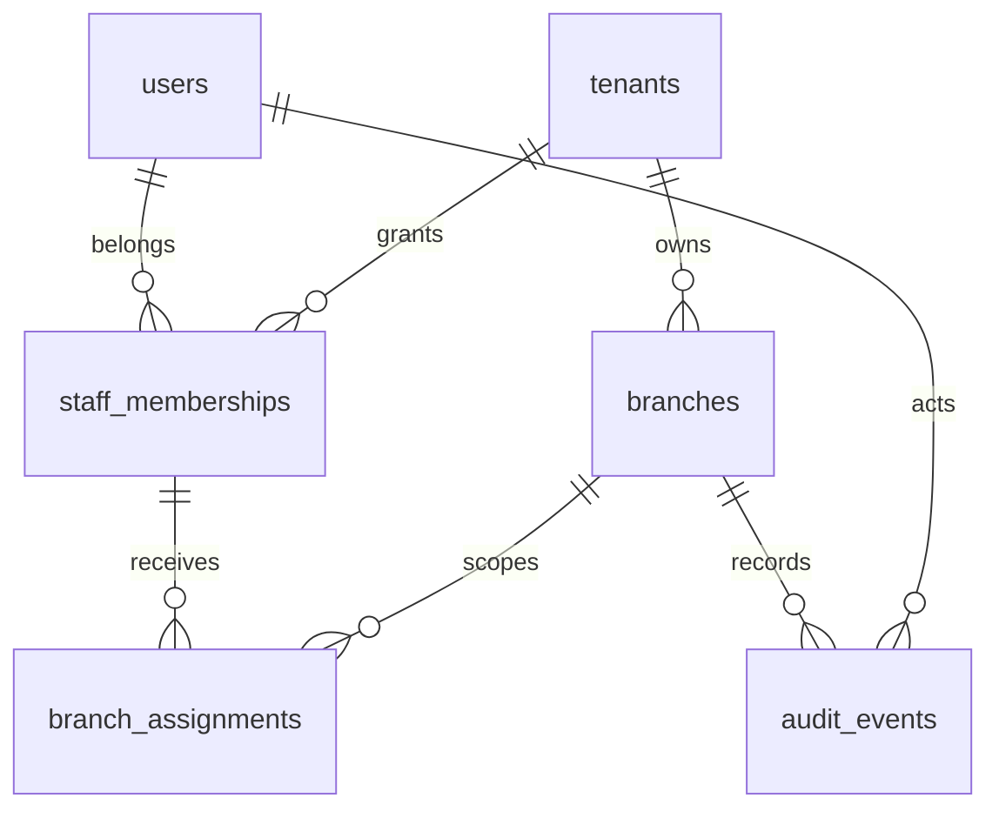

# 현재 아키텍처

기준: 2026-10-14. [README](../README.md) · [멀티테넌트 확장 설계](MULTITENANT_ARCHITECTURE.md)

## 제품과 실행 경계

현재 저장소에는 샘플 화면과 초기 서버 기반이 함께 있어요. 기존 데모는 샘플 데이터를 사용해요. 새 `/login`과 `/workspace`는 서버 인증과 조직·지점 DB 서비스에 연결돼요. 인증 없는 기존 화면에 실데이터를 바로 넣으면 안 돼요.

## 모듈 책임

| 위치 | 책임 | 주의할 경계 |
| --- | --- | --- |
| `src/app` | 관리자·회원·문의·소개 페이지 | 기존 데모와 인증된 workspace. 페이지 존재 자체는 권한이 아님 |
| `src/components` | 공통 UI와 화면 동작 | 실제 업무 권한·저장 결과의 기준으로 사용하지 않음 |
| `src/data` | 고정 시점 샘플 시나리오 | 운영 데이터 이관 대상 아님 |
| `src/server/auth/session.ts` | 검증된 내부 사용자 ID·세션 만료 확인 | provider.ts·client.ts가 검증·쿠키·ID 매핑 담당 |
| `src/server/access/tenant.ts` | 최소 권한 DB 계정 확인, 활성 사용자·조직·소속 검사 | 클라이언트가 사용자 ID/역할을 지정하는 공급자를 만들지 않음 |
| `src/server/services/branches.ts` | 지점 조회·권한 있는 이름 변경 | 향후 액션/핸들러에서 검증된 공급자로 호출 |
| `src/server/db/pool.ts` | `DATABASE_URL` 연결 풀 | 관리자 URL로 대체하지 않음 |
| `db/migrations` | 스키마·제약·역할·RLS 정책 | 이미 적용된 파일 변경 금지, 다음 마이그레이션 추가 |

## 데이터 모델과 권한

테이블은 `app` 스키마에 있어요. `users`는 인증 공급자의 issuer/subject와 내부 UUID를 연결해요. 조직별 `staff_memberships`를 통해 동일 사용자가 여러 조직에 참여해요. `branch_assignments`는 소속과 지점을 **tenant_id를 포함한 복합 외래 키**로 연결해서 다른 조직의 지점을 잘못 배정할 수 없게 해요.

현재 구현된 행동 권한은 아래 범위예요. 예약·AI·청구 권한을 뜻하지 않아요.

| 역할 | 지점 목록 조회 | 지점 이름 변경 |
| --- | --- | --- |
| tenant_admin | 자기 조직의 활성 지점 | 자기 조직의 활성 지점 |
| branch_owner | 배정된 활성 지점 | 배정된 활성 지점 |
| manager / staff | 배정된 활성 지점 | 불가 |
| 미인증·비소속·정지 사용자 | 불가 | 불가 |

## 요청과 변경 처리

1. 공급자의 검증된 세션을 받아 UUID·만료를 검사해요. Supabase Auth를 첫 공급자로 선정했으며 인증 어댑터를 구현했어요. [선정 근거](PROVIDER_DECISION.md)를 봐요.
2. 풀에서 연결 하나를 빌려 트랜잭션을 시작하고 실행 계정이 superuser·BYPASSRLS·app 테이블 소유자가 아닌지 확인해요.
3. `set_config(..., true)`로 사용자·조직을 트랜잭션에만 설정하고, DB에서 활성 소속과 조직을 확인해요.
4. 명시적인 조직 조건과 RLS를 함께 적용해요. 컨텍스트가 없으면 업무 행이 보이지 않아요.
5. 이름 변경은 지점 권한 검사 → 행 잠금 → 예상 버전 비교 → 수정·버전 증가 → 감사 기록 순서예요. 실패하면 함께 롤백해요.
6. 세션이 만료되지 않았는지 다시 확인한 뒤 커밋하고 연결을 반환해요. 롤백에 실패한 연결은 폐기해요.

트랜잭션 전체는 같은 연결을 사용해야 해요. 콜백 밖으로 client를 반환하거나 기다리지 않은 비동기 작업을 만들지 않아요. [node-postgres 트랜잭션 문서](https://node-postgres.com/features/transactions)

## 보안 모델의 한계

- 서버와 검증된 세션 공급자는 신뢰 경계예요. 실행 계정은 컨텍스트 값을 설정할 수 있으므로 RLS가 서버 침해나 임의 SQL 실행까지 막아주지는 않아요. 매개변수 질의와 서버 전용 모듈을 사용해요.
- RLS는 모든 업무 테이블에 ENABLE·FORCE를 적용했어요. superuser/BYPASSRLS는 이를 우회할 수 있으므로 마이그레이션 계정을 요청 처리에 쓰지 않아요. [PostgreSQL RLS 문서](https://www.postgresql.org/docs/current/ddl-rowsecurity.html)
- 소속 조회 정책은 재귀를 피하기 위해 본인의 활성 소속만 읽어요. 정지 조직의 자기 소속 메타데이터가 정책 내부에서 보일 수 있지만, 서버 진입점과 조직·지점 정책은 업무 접근을 거부해요.
- 감사 기록의 수정·삭제는 실행 계정에 허용하지 않아요. 이름 수정과 감사의 원자성은 서비스에서 보장하며, 모든 임의 SQL 변경을 자동 감사하는 시스템은 아니에요.
- 권한 회수는 다음 요청부터 확인해요. 이미 진행 중인 트랜잭션의 즉시 취소, 워커·실시간 구독 종료는 별도 구현이 필요해요.
- DB 역할·권한을 잘못 부여하면 코드만으로 모든 오설정을 탐지할 수 없어요. 실제 공급자의 역할·풀러·TLS·백업 환경에서도 격리 테스트가 필요해요.

## 다음 확장 순서

직원 관리 두 계정 E2E → 고객·회차·예약 트랜잭션 → 알림 outbox·재시도 → 구독·사용량 → 승인형 AI 순서예요. 회원·공개 문의에는 직원 소속 검사와 구분되는 별도 접근 계층이 필요해요. 파일·캐시·AI 검색·큐의 테넌트 격리는 [멀티테넌트 설계](MULTITENANT_ARCHITECTURE.md)에 남겨 두었어요.

## 개발 DB 적용 상태

2026-10-13 Supabase 서울 개발 프로젝트에 초기 마이그레이션과 제한된 실행 계정을 적용했어요. 공식 CA 검증과 transaction pooler에서 조직 격리·감사·권한 회수를 확인했어요. 10/14에는 0002와 로그인·첫 조직 생성 UI를 추가했어요. 사용자가 로그인·첫 조직/지점 생성을 완료했고 조직/지점 재조회·권한 없는 URL 404·로그아웃 후 차단을 확인했어요. 토큰 만료 후 갱신과 재로그인은 별도 검증이 남아 있어요. 자세한 절차는 [Supabase 설정](SUPABASE_SETUP.md)을 봐요.

## 인증 부트스트랩의 별도 권한

0001의 RLS 조회 함수는 SECURITY INVOKER를 유지해요. 0002의 사용자 매핑·내 조직 목록·첫 조직 생성 3개 함수만 SECURITY DEFINER로 제한된 작업을 수행해요. 고정 search_path·PUBLIC 실행 금지·서버의 검증된 ID만 전달하는 경계와 테스트는 [로그인·온보딩](AUTH_ONBOARDING.md)을 봐요.

## 직원 관리

0003은 비공개 초대 테이블·소속 버전·제한된 관리 함수를 추가해요. 최고관리자만 초대·배정·회수가 가능하고, 수락 이메일은 검증된 Auth 사용자에서 가져와요. 조직 잠금과 버전 검사로 수락/취소·배정/회수 경합을 처리해요. 지점 한 곳 배정과 복직 미지원 범위, 함수 신뢰 경계, 원격 검증은 [직원 관리](TEAM_MANAGEMENT.md)를 봐요.
