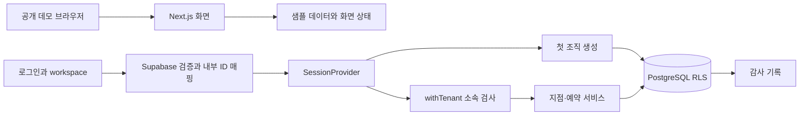
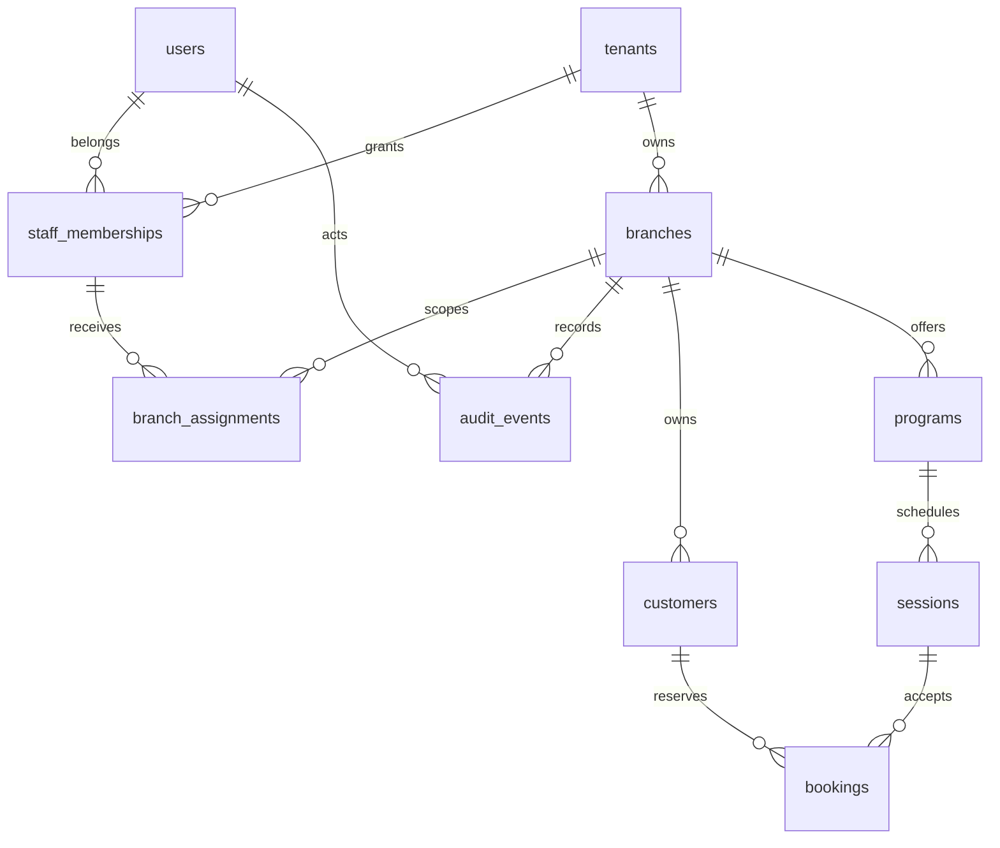

# 현재 아키텍처

기준: 2026-10-14. [README](../README.md) · [멀티테넌트 확장 설계](MULTITENANT_ARCHITECTURE.md)

## 제품과 실행 경계

현재 저장소에는 샘플 화면과 초기 서버 기반이 함께 있어요. 기존 데모는 샘플 데이터를 사용해요. 새 `/login`과 `/workspace`는 서버 인증과 조직·지점 DB 서비스에 연결돼요. 인증 없는 기존 화면에 실데이터를 바로 넣으면 안 돼요.

## 모듈 책임

| 위치 | 책임 | 주의할 경계 |
| --- | --- | --- |
| `src/app` | 관리자·회원·문의·소개 페이지 | 기존 데모와 인증된 workspace. 페이지 존재 자체는 권한이 아님 |
| `src/components` | 공통 UI와 화면 동작 | 실제 업무 권한·저장 결과의 기준으로 사용하지 않음 |
| `src/data` | 고정 시점 샘플 시나리오 | 운영 데이터 이관 대상 아님 |
| `src/server/auth/session.ts` | 검증된 내부 사용자 ID·세션 만료 확인 | provider.ts·client.ts가 검증·쿠키·ID 매핑 담당 |
| `src/server/access/tenant.ts` | 최소 권한 DB 계정 확인, 활성 사용자·조직·소속 검사 | 클라이언트가 사용자 ID/역할을 지정하는 공급자를 만들지 않음 |
| `src/server/services/branches.ts` | 지점 조회·권한 있는 이름 변경 | 향후 액션/핸들러에서 검증된 공급자로 호출 |
| `src/server/db/pool.ts` | `DATABASE_URL` 연결 풀 | 관리자 URL로 대체하지 않음 |
| `db/migrations` | 스키마·제약·역할·RLS 정책 | 이미 적용된 파일 변경 금지, 다음 마이그레이션 추가 |

## 데이터 모델과 권한

테이블은 `app` 스키마에 있어요. `users`는 인증 공급자의 issuer/subject와 내부 UUID를 연결해요. 조직별 `staff_memberships`를 통해 동일 사용자가 여러 조직에 참여해요. `branch_assignments`는 소속과 지점을 **tenant_id를 포함한 복합 외래 키**로 연결해서 다른 조직의 지점을 잘못 배정할 수 없게 해요.

아래 표는 지점 설정 권한이에요. 예약 쓰기는 최고관리자·배정된 오너/매니저에게 허용하며 직원은 조회만 가능해요. AI·청구 권한은 아직 없어요.

| 역할 | 지점 목록 조회 | 지점 이름 변경 |
| --- | --- | --- |
| tenant_admin | 자기 조직의 활성 지점 | 자기 조직의 활성 지점 |
| branch_owner | 배정된 활성 지점 | 배정된 활성 지점 |
| manager / staff | 배정된 활성 지점 | 불가 |
| 미인증·비소속·정지 사용자 | 불가 | 불가 |

## 요청과 변경 처리

1. 공급자의 검증된 세션을 받아 UUID·만료를 검사해요. Supabase Auth를 첫 공급자로 선정했으며 인증 어댑터를 구현했어요. [선정 근거](PROVIDER_DECISION.md)를 봐요.
2. 풀에서 연결 하나를 빌려 트랜잭션을 시작하고 실행 계정이 superuser·BYPASSRLS·app 테이블 소유자가 아닌지 확인해요.
3. `set_config(..., true)`로 사용자·조직을 트랜잭션에만 설정하고, DB에서 활성 소속과 조직을 확인해요.
4. 명시적인 조직 조건과 RLS를 함께 적용해요. 컨텍스트가 없으면 업무 행이 보이지 않아요.
5. 이름 변경은 지점 권한 검사 → 행 잠금 → 예상 버전 비교 → 수정·버전 증가 → 감사 기록 순서예요. 실패하면 함께 롤백해요.
6. 세션이 만료되지 않았는지 다시 확인한 뒤 커밋하고 연결을 반환해요. 롤백에 실패한 연결은 폐기해요.

트랜잭션 전체는 같은 연결을 사용해야 해요. 콜백 밖으로 client를 반환하거나 기다리지 않은 비동기 작업을 만들지 않아요. [node-postgres 트랜잭션 문서](https://node-postgres.com/features/transactions)

## 보안 모델의 한계

- 서버와 검증된 세션 공급자는 신뢰 경계예요. 실행 계정은 컨텍스트 값을 설정할 수 있으므로 RLS가 서버 침해나 임의 SQL 실행까지 막아주지는 않아요. 매개변수 질의와 서버 전용 모듈을 사용해요.
- RLS는 모든 업무 테이블에 ENABLE·FORCE를 적용했어요. superuser/BYPASSRLS는 이를 우회할 수 있으므로 마이그레이션 계정을 요청 처리에 쓰지 않아요. [PostgreSQL RLS 문서](https://www.postgresql.org/docs/current/ddl-rowsecurity.html)
- 소속 조회 정책은 재귀를 피하기 위해 본인의 활성 소속만 읽어요. 정지 조직의 자기 소속 메타데이터가 정책 내부에서 보일 수 있지만, 서버 진입점과 조직·지점 정책은 업무 접근을 거부해요.
- 감사 기록의 수정·삭제는 실행 계정에 허용하지 않아요. 이름 수정과 감사의 원자성은 서비스에서 보장하며, 모든 임의 SQL 변경을 자동 감사하는 시스템은 아니에요.
- 권한 회수는 다음 요청부터 확인해요. 이미 진행 중인 트랜잭션의 즉시 취소, 워커·실시간 구독 종료는 별도 구현이 필요해요.
- DB 역할·권한을 잘못 부여하면 코드만으로 모든 오설정을 탐지할 수 없어요. 실제 공급자의 역할·풀러·TLS·백업 환경에서도 격리 테스트가 필요해요.

## 다음 확장 순서

직원 관리 E2E와 수동 예약 트랜잭션 구현을 완료했어요. 예약 검색·변경·출석도 구현했어요. 다음은 회원 신청·승인 대기 → 알림 outbox·재시도 → 구독·사용량 → 승인형 AI 순서예요. 회원·공개 문의에는 직원 소속 검사와 구분되는 별도 접근 계층이 필요해요. 파일·캐시·AI 검색·큐의 테넌트 격리는 [멀티테넌트 설계](MULTITENANT_ARCHITECTURE.md)에 남겨 두었어요.

## 개발 DB 적용 상태

2026-10-13 Supabase 서울 개발 프로젝트에 초기 마이그레이션과 제한된 실행 계정을 적용했어요. 공식 CA 검증과 transaction pooler에서 조직 격리·감사·권한 회수를 확인했어요. 10/14에는 0002와 로그인·첫 조직 생성 UI를 추가했어요. 사용자가 로그인·첫 조직/지점 생성을 완료했고 조직/지점 재조회·권한 없는 URL 404·로그아웃 후 차단을 확인했어요. 토큰 만료 후 갱신과 재로그인은 별도 검증이 남아 있어요. 자세한 절차는 [Supabase 설정](SUPABASE_SETUP.md)을 봐요.

## 인증 부트스트랩의 별도 권한

0001의 RLS 조회 함수는 SECURITY INVOKER를 유지해요. 0002의 사용자 매핑·내 조직 목록·첫 조직 생성 3개 함수만 SECURITY DEFINER로 제한된 작업을 수행해요. 고정 search_path·PUBLIC 실행 금지·서버의 검증된 ID만 전달하는 경계와 테스트는 [로그인·온보딩](AUTH_ONBOARDING.md)을 봐요.

## 직원 관리

0003은 비공개 초대 테이블·소속 버전·제한된 관리 함수를 추가해요. 최고관리자만 초대·배정·회수가 가능하고, 수락 이메일은 검증된 Auth 사용자에서 가져와요. 조직 잠금과 버전 검사로 수락/취소·배정/회수 경합을 처리해요. 지점 한 곳 배정과 복직 미지원 범위, 함수 신뢰 경계, 원격 검증은 [직원 관리](TEAM_MANAGEMENT.md)를 봐요.

## 수동 예약

0004는 고객·프로그램·회차·예약과 제한된 쓰기 함수를 추가해요. 조회는 RLS, 쓰기는 조직/지점/역할 재검사 후 회차 잠금으로 정원을 지켜요. 예약 요청 UUID·부분 유일 인덱스·취소 버전·원자적 감사로 재시도와 충돌을 처리해요. 서울 DB 적용 및 실제 관리자 확정·취소 검증을 완료했어요. [구조·정책·제한·검증](MANUAL_BOOKINGS.md)을 봐요.

0005는 예약 이동과 별도 출석 결과·정정을 추가해요. 두 회차를 정렬해 잠그고 예상 버전·정원·마감을 검사하며 변경 전후와 사유를 감사에 남겨요. 0006은 최초 요청 회차를 보존해 이동 후 확정 재전송을 안전하게 처리해요. 예약 목록은 이름/상태/한국 날짜 검색과 50건 페이지 이동을 제공해요.

## 회원 연결과 예약 신청

0007은 `app_private.customer_links`로 확인된 계정과 지점 고객을 연결하고 `app.member_requests`로 승인 전 신청을 저장해요. 승인 시 기존 예약 확정 함수를 호출해 정원 검사·예약·신청 상태·감사를 하나의 트랜잭션으로 처리해요.

회원은 직원 소속을 만들지 않아요. 인증된 서버가 사용자 ID를 전달하면 제한된 함수가 활성 연결·조직·지점을 검사하고 본인 데이터만 반환해요. 직원 조회는 기존 RLS와 지점 권한을 적용해요. 연결 코드는 해시만 저장하고, 확인된 이메일이 일치해야 수락할 수 있어요. 기존 프로그램은 기본 닫힘이며 관리자 확인형이 기본이며 프로그램별 자동 확정도 지원해요. [사용법·신뢰 경계·잠금·제한·검증](MEMBER_BOOKINGS.md)을 봐요. 서울 개발 DB에 0001~0019을 적용했어요.

## 실제 데이터 화면 구성

`components/workspace`의 WorkspaceFrame은 회원 모바일과 운영 데스크톱 레이아웃을 나눠요. MemberBookingView는 서버에서 조회한 본인 데이터로 하단 메뉴·카드·신청 시트를 구성하고 기존 Server Actions를 호출해요. BookingTabs는 서버가 권한 검사 후 만든 업무 패널을 전환해요. 탭 숨김은 권한 검사가 아니며 모든 서버 권한 검사는 유지해요. 샘플 데모 컴포넌트의 고정 사용자·카운트·링크는 가져오지 않아요.

0008은 회원 본인의 확정 예약 취소를 추가해요. 활성 고객 연결과 조직·지점을 재검사하고 회차→예약 잠금, 기대 버전, 시작 24시간 전 마감을 확인해요. 예약 취소·정원 반환·실제 회원 행위자 감사 기록이 한 트랜잭션으로 처리되며, 관리자 변경과 경합하면 한쪽만 성공해요.

0009는 회원이 확정 예약을 같은 지점·같은 프로그램의 다른 회차로 직접 옮기는 함수를 추가해요. 신규 신청의 관리자 확인 절차와는 별개이며 기존 예약 ID를 유지해요. 활성 연결→UUID 순 양쪽 회차→예약→프로그램 정책 잠금으로 정원과 열린 정책을 검사하고 기대 버전·양쪽 24시간 마감·중복 예약/대기 신청을 확인해요. 이동과 감사 기록은 원자적이며 실패하면 기존 자리가 유지돼요. 회원 조회는 회차/프로그램 ID와 변경 가능 여부만 추가하고 내부 사유·타인 정보는 노출하지 않아요.

0010은 프로그램·신청에 확정 방식을 저장해요. 기존 데이터는 manual을 유지하고 운영자가 automatic을 명시적으로 선택해야 해요. 회원 신청은 연결→회차→프로그램 공유 잠금으로 활성 권한·마감·정원·중복·화면의 기대 방식을 검사해요. 자동 확정은 신청·예약·승인 결과·회원 행위자 감사 기록을 같은 트랜잭션에 저장해요. 직원 전용 확정 함수를 우회 호출하거나 회원에게 직원 권한을 부여하지 않아요. 기존 요청 키는 원래 신청 결과만 반환하므로 설정 변경·취소 후 재시도도 예약을 재생성하지 않아요. 기존 pending 신청은 자동 전환하지 않아요.

0011은 비공개 등록 요청 원장(registration_requests)을 추가해요. 지점·요청 UUID를 기준으로 트랜잭션 advisory lock을 잡고 고객/프로그램/회차 등록과 요청 결과·감사를 함께 커밋해요. 재시도 때도 운영 권한을 검사하고 동일 요청/정규화 입력이면 같은 ID, 다른 입력이면 충돌을 반환해요. 앱 서버 등록 경로는 모두 이 함수를 거쳐요. 기존 저수준 생성 함수는 호환용으로 유지하며 자체 요청 키는 없어요.

선택 검색은 인증된 withTenant 트랜잭션에서 활성 지점 접근과 RLS를 검사하고 해당 지점 전체를 검색해 50건과 추가 결과 여부만 반환해요. 표시는 선택용 ID·라벨·만석 여부로 제한해요. 현재 조회 방식은 부분 문자열 검색이므로 데이터 규모가 커지면 검색 인덱스·키셋 페이지 이동을 추가해야 해요.

0012는 예약 확정/변경/취소 트리거에서 비공개 outbox를 함께 기록해요. 별도 NOLOGIN 워커 역할의 제한된 함수만 점유·완료할 수 있고 60초 lease·새 토큰·최대 5회 재시도·같은 예약 버전 순서를 적용해요. 외부 전송과 워커 배포는 미연결이에요. [상태·권한·복구·검증](NOTIFICATION_OUTBOX.md)을 봐요.

0013은 운영 권한을 재검사하는 지점별 대기열 조회 함수를 추가해요. 원본 테이블·payload·lease token을 노출하지 않고 필요한 표시 필드와 상태 집계, 50건 목록만 반환해요. 일반 직원/회원과 타 지점은 거절하며 알림 현황 탭에서 조회해요. 0014는 예약→큐 잠금, 세대 검사, 24시간/최신 버전/시작 전 조건, 최대 3회 제한과 원자적 감사 기록을 갖춘 관리자 재처리를 추가해요. 실제 발송 정책은 별도 구현이 필요해요.

0015는 연결 ID 기준 이메일 수신 선택·버전·동의 이력을 private 영역에 저장해요. 회원 본인만 설정하며 worker-only 준비 함수는 유효한 lease와 활성 조직/지점/연결/사용자, 동의 이후 최신 이벤트, 24시간/시작 전, 채널 상태를 검사해요. `authorizeBookingDelivery`는 현재 인증 이메일 콜백 확인 뒤 DB를 재검사해요. 채널 기본 off, 실제 인증·전송 adapter/스케줄은 미연결이에요. [발송 경계와 남은 작업](NOTIFICATION_OUTBOX.md)을 봐요.

0016: 점유 작업에 한정한 Auth issuer/subject 조회 및 원자적 결과 기록. 워커는 기본 off·건별 점유·최종 판정 후 provider adapter 실행이며, 현재 Supabase 조회/Resend 선택형 adapter 코드는 합성 HTTP로 검증했어요. 실제 키/발신자/워커 계정/스케줄은 미설정이에요. 상세는 `NOTIFICATION_OUTBOX.md`의 0016 절을 봐요.

0017의 관리자 조회는 결과 이력에서 최신 한 건의 분류/회차/시도/시각만 투영해요. 파일럿 점검 CLI는 웹 환경과 분리되며 기본 네트워크 없음, 선택 DB 검사도 읽기 전용이에요.

0018부터 `runNotificationBatch`는 조직·지점 scope를 필수로 받고 해당 범위에서만 점유·만료 복구해요. 읽기 전용 미리보기는 집계만 반환해요. 전용 워커 역할은 여전히 신뢰된 조직 공통 역할이며, 이 scope는 실행 범위 제한이지 워커 DB 자격 증명의 조직별 권한 경계는 아니에요.

파일럿 CLI(`scripts/notification-pilot.mjs`)는 웹 런타임과 별도 환경 파일/DB pool을 사용해요. 기본 읽기 전용이며 명시적 실행 옵션과 환경 활성화가 모두 있어야 사전 권한·범위·채널 검사 후 기존 워커와 공급자 adapter를 연결해요. provider adapter는 실행 경로에서만 동적으로 로드하며 원시 오류와 개인정보는 출력하지 않아요.

0019는 공급자 접수 receipt와 전달 사실 원장을 분리해요. 웹 callback은 Svix 검증 후 별도 webhook DB 역할의 저장 함수만 호출해요. 이벤트 ID 중복 제거와 이메일 ID 매핑으로 도착 순서에 의존하지 않으며, 주소/본문을 저장하거나 큐를 재실행하지 않아요. 지점 관리자 조회는 기존 소속 권한을 재검사해요.
