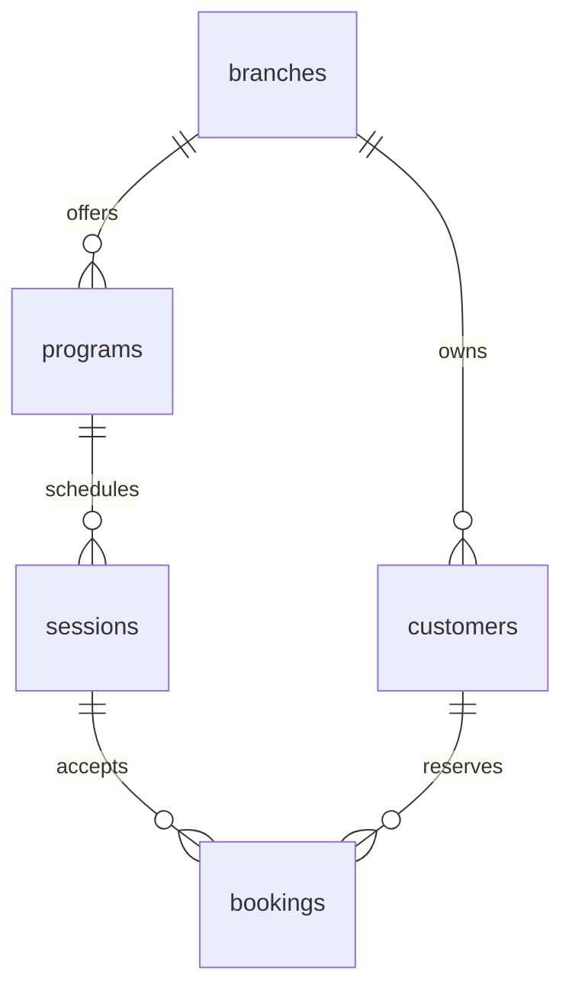

# 수동 예약 — 검색·변경·출석 운영

2026-10-15. [README](../README.md) · [아키텍처](ARCHITECTURE.md)

## 사용법과 범위

관리자 계정으로 `/workspace` → 조직 → 지점의 **예약 관리**를 열어요.
주소는 `/workspace/[tenantId]/branches/[branchId]/bookings`예요.

1. 고객 이름과 프로그램 이름을 등록해요. 고객은 해당 지점에만 소속돼요. 회원 로그인 연결은 별도 [회원 연결 관리](MEMBER_BOOKINGS.md)에서 수행해요.
2. 프로그램을 선택하고 미래의 시작·종료 시각과 정원(1~1000명)을 입력해 회차를 만들어요.
3. 고객과 회차를 고르고 확인 체크 후 예약을 바로 확정해요.
4. 예약 내역을 고객/프로그램 이름·예약 상태·출석 상태·회차 시작일(한국 날짜)로 검색해요. 50건씩 이전/다음 페이지로 이동해요.
5. 예약 변경을 펼쳐 같은 지점·같은 프로그램의 다른 회차로 옮겨요. 기존·새 회차 모두 시작 24시간 전이어야 하고 변경 사유가 필요해요.
6. 사유와 확인 체크를 입력하면 취소해요. 시작 24시간 전까지만 가능하고 정원이 즉시 복구돼요.
7. 회차 시작 후 출석, 종료 후 노쇼를 기록해요. 수정 사유를 남기고 출석/노쇼/미기록으로 정정할 수 있어요. 시간이 지나도 자동으로 출석 처리하지 않아요.

입력·표시는 한국 시간(Asia/Seoul), 저장은 `timestamptz`예요. 운영자가 직접 확정하는 범위이며, 회원 신청의 승인 대기·프로그램별 자동 확정 정책을 대체하지 않아요. 알림은 발송하지 않아요.

| 역할 | 고객·프로그램·회차·예약 조회 | 등록·확정·변경·취소·출석 |
| --- | --- | --- |
| 최고관리자 | 자기 조직의 활성 지점 | 가능 |
| 사업장 오너·매니저 | 배정된 활성 지점 | 가능 |
| 직원 | 배정된 활성 지점 | 불가 |
| 비소속·회수·정지 사용자 | 불가 | 불가 |

이 역할별 쓰기 범위는 첫 수동 예약 구현 기준이에요. 향후 직원별 세부 운영 권한을 추가할 때 중앙 권한 검사와 DB 함수를 함께 변경해야 해요.

## 코드와 데이터 구조

| 위치 | 책임 |
| --- | --- |
| `db/migrations/0004_manual_bookings.sql`·`0005_booking_operations.sql`·`0006_booking_request_origin.sql` | 예약 기반, 변경·출석 함수, 최초 요청 회차 보존 |
| `src/server/services/bookings.ts` | 입력 검증, 인증·소속 트랜잭션, 필요한 필드만 조회 |
| `src/app/workspace/booking-actions.ts` | 매 요청 인증, 사용자 입력 해석, 오류 안내·화면 갱신 |
| `src/app/workspace/[tenantId]/branches/[branchId]/bookings/page.tsx` | 지점별 운영 화면 |
| `tests/bookings.test.ts` | 실제 PostgreSQL 권한·격리·경합·취소 테스트 |
| `scripts/verify-hosted-bookings.mjs` | 원격 개발 DB 검사 후 전체 롤백 |

모든 업무 행에 `tenant_id`, `branch_id`를 저장해요. 프로그램→회차, 고객/회차→예약의 외래 키에 둘 다 포함해 다른 조직뿐 아니라 같은 조직의 다른 지점도 섞이지 않게 해요. 고객의 지점 간 공유는 아직 지원하지 않아요.

## 변경의 안전성

- 네 테이블 모두 RLS ENABLE/FORCE, runtime에는 SELECT만 부여해요. 쓰기는 제한된 SECURITY DEFINER 함수만 가능해요. 고정 `search_path`, 완전 수식 테이블 이름, PUBLIC 실행 금지, 내부 권한·감사 helper의 runtime 실행 금지를 적용했어요.
- 사용자 ID는 서버의 검증된 세션에서 `withTenant`가 설정해요. DB 함수는 활성 조직·사용자·소속·배정·지점을 다시 검사해요. URL·hidden 필드·bind 값은 권한 증거로 사용하지 않아요.
- 조직 SHARE 잠금 → 지점 SHARE 잠금 → 회차 UPDATE 잠금 순서예요. 직원 역할 변경·회수의 조직 UPDATE 잠금과 직렬화되고, 같은 회차의 확정·취소는 한 번에 하나씩 처리돼요.
- 회차 잠금 뒤 확정 건수를 세어 정원을 확인해요. 같은 고객의 동일 회차 활성 예약은 부분 유일 인덱스로 한 건만 허용해요.
- 확정 요청 UUID는 지점 안에서 유일해요. 같은 요청·같은 내용 재전송은 기존 예약 ID를 반환하고 중복 감사도 만들지 않아요. 취소된 예약의 원래 확정 요청을 다시 보내도 부활하지 않아요. 다른 내용으로 재사용하면 거부해요. 취소 후 새 예약은 새 요청 UUID를 사용해요.
- 취소는 예상 버전·확정 상태·24시간 마감을 검사해요. 사유와 취소 시각을 저장하고 버전을 증가시켜요. 사유는 필수예요.
- 업무 변경과 감사 INSERT는 같은 트랜잭션이에요. 감사 실패나 세션 만료 시 전부 롤백해요. 생성·확정·취소 감사에는 엔터티 ID를 저장해요. 이동·출석 감사에는 변경 전후·버전·사유도 기록해요. 고객 이름은 복제하지 않아요.
- 서버와 runtime 연결은 신뢰 경계예요. runtime으로 임의 SQL을 실행할 수 있는 서버 침해까지 막는 모델은 아니에요. 마이그레이션 소유자는 RLS를 우회하므로 요청 처리에 사용하지 않아요.

## 첫 흐름 확인 결과 (확장 전)

- 설정 7개 + DB 통합 39개 = **46개 테스트 통과**. 예약 테스트 8개 묶음은 권한·조직/지점 격리, 복합 FK, 마지막 자리 경합, 요청 재시도, 중복 예약, 취소·정원 복구·오래된 버전, 마감, 감사 실패 롤백, 회수/정지/닫힌 지점 차단을 포함해요.
- 타입 검사·린트·Webpack 프로덕션 빌드 통과. 기본 Turbopack은 앞선 환경의 포트 생성 오류 때문에 이번에도 검증된 Webpack 경로를 사용했어요.
- 서울 개발 DB에 0004 적용. `node scripts/verify-hosted-bookings.mjs PROJECT_REF`로 실제 runtime의 고객→프로그램→회차→예약→재시도→취소·감사·컨텍스트 격리를 확인하고 롤백했어요.
- 실제 관리자 브라우저에서도 고객·프로그램 등록, 10/20 15~16시 한국 시간 회차 생성, 정원 0/1→확정 1/1→취소 0/1, 새로고침 후 저장을 확인했어요.
- 실제 개발 조직에는 이름이 ‘개발 검증’으로 시작하는 고객·프로그램 각 1개, 회차 1개, 취소된 예약 1건이 남아 있어요. 실제 고객 연락처·발송·결제는 사용하지 않았어요.
- 데스크톱 화면 확인 완료. 모바일 전용 UI·직원/매니저의 예약 화면 브라우저 검증은 후속이며 해당 권한은 DB 통합 테스트로 확인했어요. Figma에는 새 화면을 아직 반영하지 않았어요. 공개 배포·커밋·푸시는 하지 않았어요.

## 다음 보완

예약 내역에는 검색·50건 페이지 이동을 제공해요. 고객/프로그램/예정 회차 현황 목록은 최대 200개예요. 등록·회원 연결·예약 변경의 선택 검색은 지점 전체에서 최대 50건씩 찾고 초과 시 검색어를 좁히도록 안내해요. 현황/설정 목록 페이지 이동, 고객 연락처/동명이인 식별·중복 정리, 프로그램/회차 편집·휴강, 대기열, 알림 outbox는 후속 구현이에요. 관리자 확인형 회원 신청·승인 대기는 [회원 신청](MEMBER_BOOKINGS.md)에 구현 범위를 정리했어요. 전체 감사 이력 조회 UI와 휴강·참석 확인 응답 등 취소 마감 예외도 아직 제공하지 않아요.

## 예약 변경·출석 확장 검증

0005는 회차 이동과 출석 기록·정정을 추가했어요. 이동은 원본/대상 회차를 UUID 순서로 잠근 다음 예약을 잠가 반대 방향 이동의 교착을 방지해요. 예상 버전·정원·동일 프로그램·24시간 마감을 검사해요. 출석 결과는 예약 상태와 독립적이며 시작 전 출석·종료 전 노쇼·취소 예약의 기록을 거부해요. 이동·출석 감사에는 이전/이후 회차 또는 결과·버전·사유·행위자를 남겨요.

0006은 `requested_session_id`로 최초 요청 회차를 보존해요. 이동 후 원래 확정 요청을 다시 보내도 기존 예약 ID를 반환하며 다른 내용으로 요청 키를 재사용하면 거부해요. 기존 데이터는 최초 이동 감사의 원본 회차로 채워요.

당시 검증은 **52개(설정 7 + DB 45) 통과**, 타입·린트·Webpack 빌드 통과예요. 예약 테스트 14개 묶음에 이동/신규 예약의 마지막 자리 경합, 반대 방향 이동, 감사 롤백, 이동 후 원래 요청 재시도, 출석 시간·정정·버전 경합, 검색·한국 날짜 경계·50건 페이지 이동이 포함돼요. 서울 개발 DB에 0005·0006을 적용했고 원격 이동·출석/정정 검증은 전부 롤백해요.

실제 관리자 화면에서 10/20→10/21 회차 이동·정원·이름/날짜 검색을 확인했어요. 짧은 검증 회차(10/14 09:06~09:07) 종료 후 노쇼→출석 정정·새로고침·출석 필터도 확인했어요. 개발 데이터는 고객·프로그램 각 1개, 회차 3개, 예약 3건(취소 1·미래 확정 1·출석 기록 1)이 남아 있어요. 회원 메시지·결제는 발생하지 않았어요. 기존 첫 흐름의 46개 검증 기록은 위의 이전 기준이에요.

고객/프로그램/회차 생성 재시도는 아래 0011에서 보완했어요. 조직 회수 후 안내 UX와 토큰 만료 갱신 검증도 남아 있어요. 실제 운영 가능 판정은 이 첫 흐름 검증과 구분해요.

## 등록 재시도·선택 검색 (2026-10-15)

고객·프로그램·회차 등록은 같은 요청 키와 같은 입력을 다시 보내면 기존 ID를 반환해요. 동시 요청도 한 건만 만들고 감사 기록도 한 번만 남겨요. 같은 키에 다른 내용을 넣으면 충돌로 거절해요. 이름이 같은 서로 다른 고객은 있을 수 있어 **이름 자체를 유일하게 제한하지 않아요**.

- DB: `0011_registration_requests.sql`의 private 원장에 지점·요청 키·종류·정규화 입력·결과 ID를 기록해요. runtime 직접 접근을 금지하고 매 재시도 운영 권한을 재검사해요. 등록·감사·원장은 함께 롤백돼요.
- 화면: `registration-form.tsx`가 재렌더링·재시도 동안 요청 키를 유지해요. 성공 후 입력 폼을 완료 안내로 바꾸고 ‘새 등록 시작’에서 새 키를 만들어요. 예약 확정 폼도 같은 방식을 사용해요.
- 검색: `search-select.tsx`와 서버 `searchBookingChoices`가 고객·프로그램 이름/짧은 ID, 회차 프로그램명/한국 날짜를 검색해요. 등록·회원 연결·관리자 예약 변경에 적용했어요.
- 기본 목록에 없는 201번째 이후 데이터도 찾을 수 있어요. 결과는 최대 50개이며 더 많으면 검색어를 좁히도록 안내해요. 만석 선택은 비활성화하고 저장 직전 DB에서도 재검사해요. 검색 Enter는 등록을 제출하지 않아요.

브라우저 새로고침·다른 탭·‘새 등록 시작’은 별도 요청이에요. 같은 내용을 새 키로 입력하는 중복은 자동 병합하지 않아요. 원장에 입력을 보관하므로 향후 고객 삭제/보관 정책에 이 원장도 포함해야 해요. 원장 만료/정리와 현황·프로그램 설정 전체 목록의 페이지 이동은 후속 범위예요.

**검증**: 설정 7 + DB 70 = 총 77개, 타입·린트·Webpack 빌드 통과. 동일 키 동시 등록, 다른 입력 충돌, 감사 실패 롤백, 지점별 요청 분리, 200건 초과 검색, 권한·RLS, 날짜·만석 검사를 포함해요. 서울 개발 DB에 0011을 적용하고 등록 재시도·예약·감사를 전체 롤백으로 확인했어요.

실제 컴포넌트와 프로덕션 빌드 CSS를 사용한 로컬 합성 데이터 화면에서 390px 검색 Enter·선택 유지·부모 재렌더링·완료 안내·새 등록 초기화·다음 등록을 확인했어요. 이 미리보기의 검색/저장은 mock이며 실제 관리자 로그인 후 Server Action 제출 검증은 별도로 남아 있어요. 인증 우회나 실제 고객 추가는 하지 않았고, 커밋·공개 배포도 없어요.
